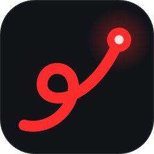

<p align="center"></p>

# Laser Pointer

Draw over anything while you present — a smooth, fading laser for Windows.

[](https://github.com/ayricky/laser-pointer/actions/workflows/ci.yml)

[Live demo](https://ayricky.github.io/laser-pointer/) ·
Microsoft Store (coming soon) ·
[Releases](https://github.com/ayricky/laser-pointer/releases)

<!-- Replace the Microsoft Store placeholder with the product URL once the listing is live. -->

## Features

- Smooth trails that taper by distance and fade over time. Solid, Glow and Neon styles, any colour,
  and adjustable thickness, opacity, fade, trail length and smoothing.
- Laser, Highlighter and Pen presets; create, rename, update and delete your own, up to eight.
- Keep annotations on screen while the laser is off and clicks pass through. Each stroke remembers
  its look. Undo, redo, and Clear with a gentle fade; undo also restores a Clear.
- Rebind or remove any shortcut, including preset shortcuts and single keys.
- Right-click to pass a click through; scroll the app underneath; Ctrl+wheel adjusts thickness.
- Laser-dot cursor, click ripples and an on-screen indicator for toggles and preset changes.
- Tabbed settings with a live preview, Windows light/dark theme and accent colour. Left-click the
  notification-area icon to open it. Optional start with Windows.
- A lightweight overlay that hides when empty and redraws only the parts of the screen that change.

## Default shortcuts

| Action | Shortcut | Active |
| --- | --- | --- |
| Turn laser on or off | Alt+L | always |
| Turn laser off | Esc | while the laser is on |
| Undo last stroke or Clear | Ctrl+Z | while the laser is on |
| Redo | Ctrl+Y | while the laser is on |
| Clear strokes | Alt+X | while strokes are on screen |
| Keep strokes on or off | Alt+K | always |
| Next / previous preset | Alt+] / Alt+[ | always |
| Quit | Alt+Shift+L | always |

While the laser is on: drag to draw, right-click to click through, scroll to scroll the app
underneath, and Ctrl+scroll to change thickness.

## Install

- **Microsoft Store (coming soon):** US$2.99 for a signed build with automatic updates.
- **Release zip:** download `laser-pointer-<version>-x64.zip` from
  [Releases](https://github.com/ayricky/laser-pointer/releases), extract it and open `laser-pointer.exe`.
  GitHub MSIX files are unsigned and intended for Store submission or developer sideload testing.
- **Build:** follow the instructions below; building it yourself is always free.

Requires Windows 10 1809 or later, x64. The app lives in the notification area. Press Alt+L to
draw; left-click its tray icon for settings. Starting it again opens the running copy's settings.

## Build from source

Requires Windows 10 1809 or later and Rust (1.93 stable with the MSVC toolchain is supported).

```powershell
cargo build --release --target-dir target-codex
cargo test --target-dir target-codex
cargo clippy --target-dir target-codex
```

The executable is `target-codex\release\laser-pointer.exe`. Using a separate target directory
also avoids overwriting a running copy in `target\release`.

The default MSVC toolchain needs Visual Studio Build Tools and the Windows 10/11 SDK (`rc.exe`
embeds the icon and version resources). With the GNU toolchain (`x86_64-pc-windows-gnu`), put a
MinGW-w64 `bin` folder (for `dlltool`, `as` and `windres`) on `PATH`.

To regenerate the branding assets, install the dependencies declared in `tools/brand/package.json`
there, then run from the repository root:

```powershell
node tools/brand/generate.mjs
```

To create an unsigned Store package (Windows SDK required):

```powershell
./packaging/build-msix.ps1 -TargetDir target-codex
```

The package is written to `dist/`. Supply your Partner Center identity for submission; see
[the submission checklist](store/SUBMITTING.md). Optional PFX signing is for developer sideload
testing; the Store signs submitted packages. Nothing is installed by the packaging script.

## Privacy

No personal data collection, network connections, telemetry, ads or accounts; settings stay on your PC.
Read the [privacy policy](https://ayricky.github.io/laser-pointer/privacy.html).

## Licence

[MIT](LICENSE). The Store version is the same code; buying it supports development and provides
signed distribution and automatic updates. The cursor artwork comes from
[Excalidraw](https://github.com/excalidraw/excalidraw) under the MIT licence; see
[THIRD-PARTY-NOTICES.txt](THIRD-PARTY-NOTICES.txt).
